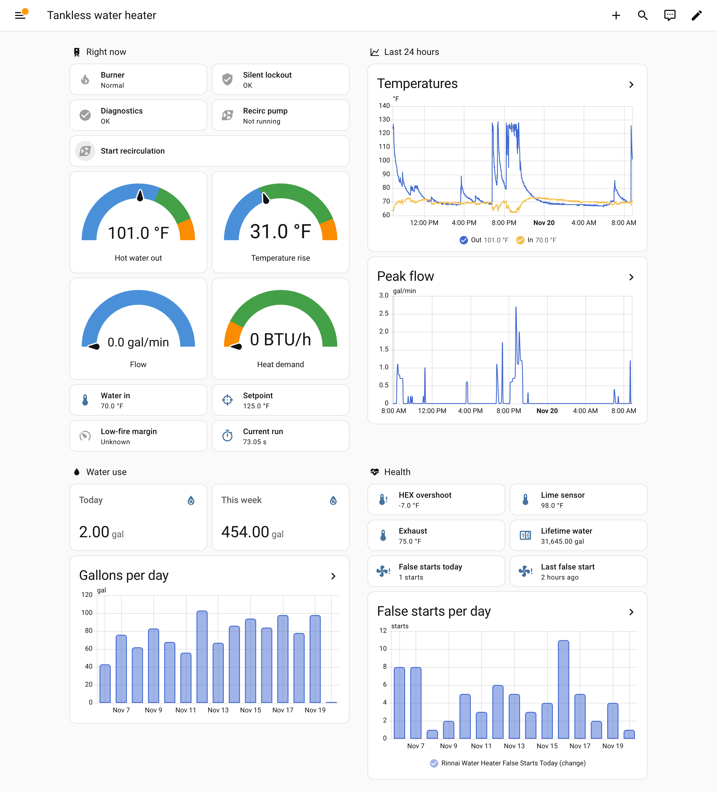

# Rinnai RXP199iN water heater for Home Assistant (local Bluetooth)

A Home Assistant integration that reads a **Rinnai SENSEI RX/RXP** tankless
water heater directly over its built-in Bluetooth. No cloud, no Wi-Fi module, no
Rinnai account. Developed and tested against an **RXP199iN**; other RX/RXP
models with the same Bluetooth module will likely work.

It shows what the heater is doing right now (burner, flow, temperatures,
setpoint, recirculation pump), tracks water use and heater health over time,
and warns about low-flow lockouts and false starts. As of 1.4.0 it can also
**start a recirculation run** and **change the setpoint** through an opt-in
experimental action.



The dashboard above is included as [extras/dashboard.yaml](extras/dashboard.yaml).

The protocol was reverse-engineered from scratch and is documented in
**[PROTOCOL.md](PROTOCOL.md)**. Normal operation is read-only; the two control
commands are described under [Control (experimental)](#control-experimental).

## What you get

| Type | Entities |
|---|---|
| Sensors | Outgoing, Inlet, HEX Outlet, Exhaust and Lime Detecting temperatures, Water Flow Rate, Temperature Rise, Water Through Heater (lifetime gallons, includes recirculation) |
| Diagnostic sensors | Setpoint, Freeze Protection temperature, Fan Frequency/Current, Bypass Position, Combustion and Pump Cycles/Hours, Total Heat Energy, Diagnostic Code, raw `\K`/`\L` frames and two not-yet-decoded `\L` fields (disabled by default) |
| Binary sensors | Combustion, Recirculation Pump, Diagnostic Code Active, Silent Lockout, Internal Pump Installed |
| Low-flow lockout | Heat Demand (BTU/h), Low-Fire Margin (%), HEX Overshoot, Silent Lockout (see below) |
| False starts | False Start event, False Starts Today count (see below) |
| Control (experimental) | `rinnai_ble.experimental_write_k` action: start recirculation, set the setpoint (see below) |

## Requirements

- Home Assistant 2025.2 or newer.
- A Bluetooth adapter on the Home Assistant host within range of the heater.
  **A local USB adapter is strongly preferred**; bonding through an ESPHome
  proxy was unreliable on the development unit, though one user reports it
  working with the adapter pinned to the proxy (issue #1).
- Ideally an adapter **dedicated** to the heater, or at least one that is not
  also holding connections to other devices. The heater keeps one connection
  open permanently, and older CSR8510 dongles handle only one connection
  attempt at a time, so other Bluetooth devices queue behind it. A Realtek
  RTL8761B-based adapter is a good choice.
- Physical access to the heater once, to press its Bluetooth button.

## Install

**HACS (recommended):** HACS → ⋮ → Custom repositories → add this repository's
URL as an *Integration*, install **Rinnai RXP199iN Water Heater (BLE)**, then
restart Home Assistant.

**Manual:** copy `custom_components/rinnai_ble/` into
`<config>/custom_components/` and restart Home Assistant (a reload is not
enough for Python changes).

Upgrading from a pre-1.0 copy: replace the folder and restart. Entity IDs and
history are kept.

## Bonding (the step everyone gets stuck on)

The heater's data characteristics need an encrypted, bonded link, and it only
accepts a bond while in pairing mode. On the Home Assistant host, with the
integration disabled and the Rinnai phone app closed:

```bash
bluetoothctl
remove AA:BB:CC:DD:EE:FF     # your heater's address; clears a stale record
power on
agent on
default-agent
scan on                      # wait for "Rinnai RX  <serial>"
# --- press the Bluetooth button on the front of the heater now (LED blinks) ---
pair AA:BB:CC:DD:EE:FF
trust AA:BB:CC:DD:EE:FF
info AA:BB:CC:DD:EE:FF       # want Paired: yes and Bonded: yes
quit
```

- Without the button press, pairing fails with `AuthenticationFailed` on any
  adapter. There is no passkey.
- **Bonds are per adapter.** Change dongles and you must bond again.
- If the heater was re-paired with the phone or lost power, it may have
  forgotten the bond. Symptoms: connections drop immediately with
  `NotConnected`, or the integration reports it "refused an encrypted
  connection". Bond again.

Then add the integration (it is usually auto-discovered).

## Options

Settings → Devices & Services → Rinnai → **Configure**:

- **Poll interval:** default 30 s. Go lower (10 s) only briefly to catch a
  short event.
- **Bluetooth adapter:** *Automatic* uses the best-placed local adapter. If you
  have several, pin the one holding the bond. A pinned adapter is strict: the
  integration waits for it rather than roaming to another radio.
- **Fast polling while active:** on by default. While the fan, burner, pump or
  flow is active, the heater is read every 5 seconds instead of the poll
  interval, so short events are caught. Turn it off if your link struggles.

## Low-flow lockout alerts

A tankless burner cannot turn down below its **minimum firing rate**
(15,000 BTU/h on the RXP199iN). When a draw needs less heat than that, the
heat exchanger overheats and the burner cuts out. Low flow with warm inlet
water (summer groundwater) is the usual cause. On the RXP199iN this has been
observed to happen **without a fault code**, with cold water continuing until
the tap is closed.

- **Heat Demand** = 500 × flow (gal/min) × (setpoint − inlet °F), in BTU/h.
- **Low-Fire Margin** = how far Heat Demand sits above the minimum firing rate,
  as a percentage; negative means below it. Unknown when no water is flowing.
  Set the minimum firing rate for your model in **Configure**.
- **HEX Overshoot** = heat-exchanger outlet minus delivered temperature. The
  bypass valve hides overheating from the delivered water, so this rises first.
- **Silent Lockout** turns on when at least 0.4 gal/min has been flowing with
  the burner off for 60 seconds and no fault code is active.

For a mixed shower, the heat needed depends on total flow and the shower
temperature, not the setpoint, so the main levers are flow (supply pressure,
shower head) rather than the setpoint.

To get notified, import the blueprint:

[](https://my.home-assistant.io/redirect/blueprint_import/?blueprint_url=https%3A%2F%2Fgithub.com%2Fnatwilson%2Fha-rinnai-rxp199in%2Fblob%2Fmain%2Fblueprints%2Fautomation%2Frinnai_ble%2Fsilent_lockout_alert.yaml)

A warning for draws running close to the floor is a plain numeric-state
automation, for example Low-Fire Margin below 10 for 1 minute.

## False starts

A brief flow blip, such as a pressure fluctuation or a tap opened for a
moment, can spin up the fan without the burner ever lighting. You hear the
blower but get no heat. The integration records each one:

- **False Start** (event entity) fires once per run, with the run's
  `duration` (s), `max_fan_frequency` (Hz) and `max_flow` (gal/min). Use it as
  an automation trigger or see it in the logbook.
- **False Starts Today** counts them, resets at local midnight and survives
  restarts. Long-term statistics give a daily history.

A run counts as a false start if the fan ran but no combustion, pump run or
heat exchanger warming was seen. Detection depends on fast polling: an event
shorter than the poll interval that begins and ends between two idle polls
can still be missed, so treat the count as a lower bound.

## How it stays connected

- **One persistent connection**, opened with the `\I` session handshake the
  Rinnai app sends.
- **A missed poll is not an outage.** Values are kept and entities stay
  available until no valid data has arrived for 5 minutes.
- **Stalls are fixed in place first.** If `\L` stops answering, the session
  handshake is re-sent on the same link; the link is only rebuilt after three
  failed polls in a row.
- **Reconnects back off** (30 s doubling to 5 min) so a busy adapter isn't
  hammered. Fast polling stops whenever a poll fails.
- **Corrupt data is never shown.** Fragments are reassembled by sequence number
  (duplicates are harmless) and every frame's checksum is verified.

## Troubleshooting

| Symptom | Cause / fix |
|---|---|
| `refused an encrypted connection`, `Insufficient encryption` | Not bonded with this adapter. See *Bonding* |
| Setup retries with `NotConnected` | The heater drops the link right after connecting: usually a lost bond, sometimes the phone app holding the connection. Close the app, then bond again |
| `heater not currently visible` | No adapter can see it. Check range, close `bluetoothctl` and the phone app (the heater stops advertising while anything is connected) |
| `\L has not answered for 3 polls; reconnecting` now and then | Normal recovery. If constant, suspect RF: use a USB extension cable away from USB 3 ports |
| Other Bluetooth devices got slower | Shared adapter. See *Requirements* |

For more detail, add to `configuration.yaml`:

```yaml
logger:
  logs:
    custom_components.rinnai_ble: debug
```

**Only one central at a time:** the heater accepts a single connection, so the
Rinnai Central app and Home Assistant compete. Keep the app closed.

## Development

`custom_components/rinnai_ble/rinnai_protocol.py` has no Home Assistant
dependencies and can be reused in any Python project, or as the reference for an
ESP32/ESPHome implementation.

```bash
pip install -r requirements_test.txt
pytest
```

The codec tests alone need only the standard library:
`python -m unittest tests.test_protocol`.

To decode more fields without a packet capture, enable the **Raw Diagnostic
Frame L** / **Raw Status Frame K** sensors, put the unit in the state of
interest, and copy the hex from the entity history **as text**. PROTOCOL.md
lists what is still unmapped.

## Control (experimental)

The integration polls read-only. One opt-in action,
`rinnai_ble.experimental_write_k`, sends the normal status query with a single
byte changed. On an RXP199iN this turned out to be a working command:

| Call | Result on the test unit |
|---|---|
| `mode: 2` | Starts a recirculation run: pump and burner on within about 10 s. The heater ends the run itself (about 70 s from a cold loop, less when the pipes are warm). |
| `setpoint: <°F>` | Sets the setpoint to that value. The display follows. |

```yaml
action: rinnai_ble.experimental_write_k
data:
  mode: 2            # start recirculation
  confirm: true
```

```yaml
action: rinnai_ble.experimental_write_k
data:
  setpoint: 120      # one of 98-110 (by 2), 115, 120, 125, 130, 135, 140
  confirm: true
```

The response holds the status before and after; `status_changed: true` means
the heater acted on the write. What to expect:

- **The heater applies its own rules.** In crossover recirculation mode the
  minimum setpoint is 120 °F, so lower values land on 120. Setpoint writes are
  ignored while hot water is flowing, exactly as on the front panel. Values
  above 120 °F need the heater's maximum-temperature parameter raised.
- **A recirculation request is a request.** The heater may ignore it when the
  loop is still hot or the pump ran a few minutes ago (the manual lists a rest
  interval of 4 to 10 minutes in crossover mode).
- **130 °F and above scalds in seconds.** Nothing here lowers it again for you.
- Tested on one heater. It accepts only these two bytes and these values, and
  needs `confirm: true`.

A script makes it a dashboard button or an automation step:

```yaml
script:
  rinnai_start_recirculation:
    alias: "Rinnai: start recirculation"
    icon: mdi:pump
    sequence:
      - action: rinnai_ble.experimental_write_k
        data:
          mode: 2
          confirm: true
        response_variable: result
```

For example, call it when a dishwasher or a warm wash cycle starts, with a
condition that it last ran more than 10 minutes ago.

## Disclaimer

Not affiliated with or endorsed by Rinnai. Read-only in normal operation: it
only sends the same status queries the Rinnai app sends. The experimental
action above is the one exception and never runs unless you call it. It writes
to a gas appliance using a reverse-engineered protocol. Use at your own risk.

## License

MIT
